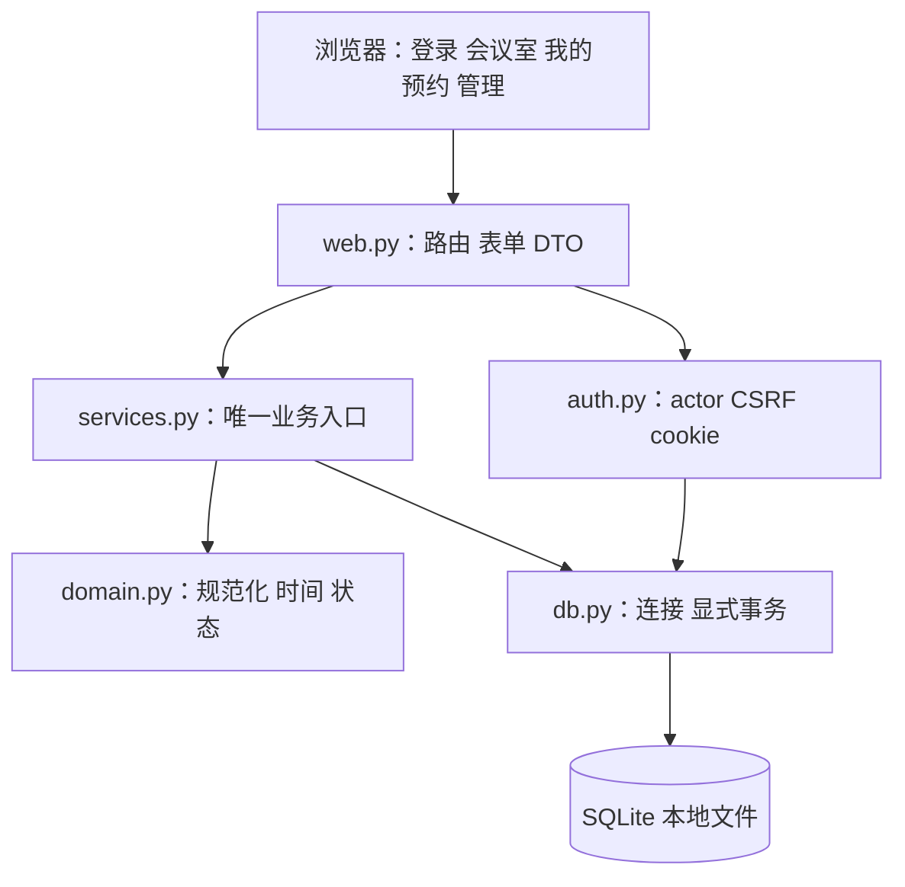

# 课题组活动与会议室预约系统架构

> 以下v1协议保留为旧基线追踪。涉及角色、预约窗口、审批、周期、共享字段和批量维护的条款，现以[获批变更方案](sprint-change-proposal-2026-11-15.md)、[PRD v2](PRD.md)及Epic4故事合同为准。新增流程已在schema v6实现，显式迁移支持已知schema 1—5；不能把旧字段/动作白名单当成新版禁止扩展。原8项ADR继续保留取舍背景，当前实现沿用分层、写事务、唯一槽、持久幂等、会话/CSRF、隐私和审计原子性。

## 1. 范围、依据与决策性质

架构采用**分层模块化单体**：Flask 同时提供 Jinja 页面与 JSON API，服务层完成业务规则，SQLite 保存全部业务、占用、会话和审计。仅需本机运行，无外部服务。依据为 [PRD](PRD.md)、[简述](product-brief.md)、[课程范围](../../docs/course-scope.md)、[界面](ux-designs/course/DESIGN.md) 与 [交互](ux-designs/course/EXPERIENCE.md)；约束摘要在 [Architecture Spine](architecture/architecture-group-room-booking-2026-11-12/ARCHITECTURE-SPINE.md)。此文 §4—§8 是 spine 的共享协议附件，实现者必须一并读取。

用户授权 AI 拟定其余规则，所以本文技术选择记为 **AI 设计决策 A-ARCH-01**，不是访谈事实、人类否决 AI 的记录或教师 M2 批准。本阶段保留真实版本核验与评审证据；PRD已结束工作流；三项独立AI架构评审已完成，发现按[修复记录](architecture/architecture-group-room-booking-2026-11-12/review-resolution.md)处理。本文final仅表示架构工作流完成，不表示应用已通过验收或教师M2批准。实验 A 保留，B 免做。

本地原型边界：同一大组内共享房间、预置账号、单服务进程、单文件数据库、浏览器页面；不提供公网托管、外部通知、账号管理网页、原子改期或硬删除历史。

2026-11-13范围复核D-005：各导师或负责人以独立账号共用同一目录和占用记录；现有member/admin角色和按房间时段唯一约束支持该范围，无需新增租户/导师组字段或改写ADR。普通学生权限及管理员人选待后续确认；本次不改变本地部署边界，也不代表真实推广完成。

## 2. 技术基线与官方核验

核验日：2026-11-12。官方页面确认版本存在与适用性；实际运行 `.tools/bin/python` 得到 Python 3.12.14 与 SQLite 3.53.1。该二者是可复现基线，不宣称最新。实现阶段固定直接依赖，生成完整依赖锁与运行环境证据；升级时重跑 NFR。

| 技术 | 固定版本/用途 | 官方依据 |
| --- | --- | --- |
| CPython | 3.12.14；标准库 sqlite3、zoneinfo、secrets、unittest | [版本发布页](https://www.python.org/downloads/release/python-31214/)，[sqlite3 文档](https://docs.python.org/3.12/library/sqlite3.html) |
| SQLite | 3.53.1；本次 Python 链接版本 | [版本发布页](https://sqlite.org/releaselog/3_53_1.html) |
| Flask | 3.1.3；路由、应用工厂、模板 | [变更记录](https://flask.palletsprojects.com/en/stable/changes/) |
| Jinja2 | 3.1.6；自动转义模板 | [变更记录](https://jinja.palletsprojects.com/en/stable/changes/) |
| Werkzeug | 3.1.9；WSGI 工具、scrypt 口令 | [变更记录](https://werkzeug.palletsprojects.com/en/stable/changes/)，[安全函数](https://werkzeug.palletsprojects.com/en/stable/utils/#werkzeug.security.generate_password_hash) |
| Waitress | 3.0.2；本地 WSGI 服务，1 进程/8 线程 | [官方文档与版本](https://docs.pylonsproject.org/projects/waitress/en/stable/index.html) |

候选起点选择 [Flask 官方 tutorial](https://flask.palletsprojects.com/en/stable/tutorial/) 的应用工厂、包目录和 blueprint 结构；这是结构参考，不引入整套示例业务，也不继承其 cookie 会话实现。没有单独生成器或前端构建链。Flask 官方部署说明要求正式运行使用 WSGI 服务，因此课堂验收用 Waitress，开发服务器只用于调试。[部署说明](https://flask.palletsprojects.com/en/stable/deploying/)

SQLite 官方说明同一数据库同时只有一个写事务，`BEGIN IMMEDIATE` 会在业务读取前取得写事务，等待冲突写入或返回 busy；WAL 改善读写并发，但不使多写者并行，也不适用于网络共享文件系统。本设计利用这些语义串行化写操作，并用唯一槽作数据库约束。[事务语义](https://sqlite.org/lang_transaction.html)、[WAL](https://sqlite.org/wal.html)

## 3. ADR：决策、备选与影响

以下 8 条与 spine AD-1—AD-8 一一对应。所有“否决”均为 AI 对技术备选的比较，**不得计入课程“人类否决/修改 AI”数量**。

| ADR | 决策及依据 | 被否决备选与理由 | 后果与验证 | 回指 |
| --- | --- | --- | --- | --- |
| ADR-01 / AD-1 | Flask 分层单体；web→services→db，domain 为纯规则 | SPA+独立 API：增加双构建和跨域认证；微服务：让单资源事务变成分布式问题；大型第三方 starter：引入未使用默认模块 | 一个启动命令、一个发布单元；共享服务保证页面/API 规则一致 | FR-01—22，NFR-01—04 |
| ADR-02 / AD-2 | UTC 整数秒存储；北京时间输入/展示；统一半开区间和 1800s 槽 | 本地无时区字符串：比较与跨日边界易分歧；浮点毫秒：增加精度和单位混用风险 | 统一 Clock；精确测试 start=t、end=t、30天、4h、跨日 | FR-06—19，NFR-01 |
| ADR-03 / AD-3 | reservations 共表；唯一占用槽；BEGIN IMMEDIATE 后读状态；业务和审计同提交 | 先查再插：竞态；预约/停用各一套唯一约束：不能跨类型互斥；仅进程 mutex：跨连接/进程保护不足 | 写操作串行，短事务；20 并发与三类双请求竞争测最终 DB | FR-10—12/17—21，NFR-01/04 |
| ADR-04 / AD-4 | 用户作用域持久意图 key；成功 payload 重放先于新预约检查 | 全局 key：跨用户碰撞；前端禁按钮：网络重试仍重复；短期响应缓存：重启丢失且取消后状态陈旧 | key 随历史保留；相同 key/不同 payload 返回 409；失败不占 key | FR-12/22，NFR-01/04 |
| ADR-05 / AD-5 | 服务端哈希随机 token，会话绝对8h、可注销；scrypt；Origin+CSRF | 只用 JWT/签名 cookie：退出后旧凭证仍可重放；只用 SameSite：不能替代明确 CSRF；明文口令：不可接受 | 每次受保护请求读会话；本地 HTTP 明确限制 loopback | FR-01—04，NFR-02 |
| ADR-06 / AD-6 | actor 由会话产生；角色/所有权检查；不同 DTO 白名单 | 隐藏按钮：直接请求可绕过；序列化完整记录后前端隐藏：敏感字段已发送 | 服务权限矩阵与泄漏断言；不存在和越权本人记录统一404 | FR-04/07/13—15/20—22，NFR-02 |
| ADR-07 / AD-7 | 取消/撤销终态；先授权原因校验再幂等；容量保护未结束预约；审计原子 | 硬删除：丢历史；重复取消覆盖原因：竞争不确定；日志异步写：业务与证据分离；停用自动取消：违背 PRD | 两个独立管理命令；每次真实转换一条审计；故障注入证实回滚 | FR-14—21，NFR-01/04 |
| ADR-08 / AD-8 | 单主机本地盘 WAL；官方 backup API；文件库真实并发测试；可注入 Clock | 云数据库：增加课堂外部依赖；共享盘 SQLite：WAL 不支持；仅内存库/单线程测试：掩盖竞态；只复制运行中主文件：可能漏 WAL | 版本/启动参数纳入证据；备份恢复后清会话；超出此部署边界重新决策 | FR-01/21/22，NFR-01—04 |

## 4. 组件、所有权与公共服务接口

模块可在实现中拆文件，但依赖方向固定。服务接受 `actor`（已认证用户 id/role/display_name 及仅内部使用的 session_token_hash）、显式业务 payload；不接收客户端 user_id 作为操作者。服务自身再次检查角色/所有权，路由检查用于尽早拒绝。成功返回领域结果，失败抛统一 `DomainError(code, message, fields, conflicts)`，由 web 映射 HTTP。

| 服务接口 | 输入 | 输出及责任 |
| --- | --- | --- |
| `list_rooms(actor)` / `availability(actor, start, end, attendees)` | 已规范化查询 | 目录/可用目录；稳定排序；只查询，不保留时段 |
| `schedule(actor, room_id, date)` | 北京日期 | 跨日停用按相交条件出现；共享 DTO |
| `create_booking(actor, payload)` | room_id,title,purpose,attendees,start,end,intent_key | `CreateBookingResult`，唯一位置为 `{booking:BookingFull,replayed:bool}`；统一事务 |
| `member_cancel_booking(actor, booking_id)` | 不接受原因覆盖 | `BookingFull`；所有权后幂等；首次仅开始前 |
| `admin_cancel_booking(actor, booking_id, reason)` | admin，非空原因 | `BookingFull`；独立命令；首次结束前；释放槽并一次审计 |
| `create_room(actor, payload)` / `update_room(actor, room_id, payload)` | admin，完整 name/location/capacity | `Room`；唯一组合/容量保护；无变化返回原值且不写审计 |
| `create_block(actor, payload)` | admin，room_id,start,end,reason | `BlockFull`；新停用；不得自动取消预约 |
| `revoke_block(actor, block_id, reason)` | admin，非空原因 | `BlockFull`；独立命令；首次结束前；释放槽并一次审计 |
| `my_bookings` / `admin_bookings` / `admin_blocks` / `audit_events` | actor，过滤条件 | 分别为 `ListResult<BookingFull>` / `ListResult<BookingFull>` / `ListResult<BlockFull>` / `ListResult<AuditEvent>` |

服务输出就是 §6.3 定义的可序列化对象，不附 `ok` 或外层 `data`；web **只包一层** `{"ok":true,"data":服务返回值}`。目录/可用性返回 `ListResult<Room>`，日程返回 `ListResult<ScheduleItem>`。`replayed` 只在 CreateBookingResult 上，不能放进 BookingFull。HTTP 状态由路由按新建/重放决定，服务的领域对象不混入响应对象。

管理员取消预约与撤销停用可以共享事务助手、原因校验与槽删除函数，但保留独立命令和独立测试；后续实验 A 候选为这两个业务规模相近的故事。故事阶段才确定配对与协议，不能预先实现两个目标，也不凭本段宣称实验已开展。

## 5. 数据协议与一致性

### 5.1 表与约束

全部实体 ID 为 SQLite `INTEGER PRIMARY KEY`；时间列为 UTC epoch `INTEGER` 秒；所有列除明确标为 NULL 的列外均为 NOT NULL。外键 `ON DELETE RESTRICT`，业务历史无删除接口。`PRAGMA foreign_keys=ON` 必须在每个连接开始事务前设置并检查；SQLite 不保证默认开启。[外键文档](https://sqlite.org/foreignkeys.html)

| 表 | 字段 | 约束与索引 |
| --- | --- | --- |
| users | id, username TEXT, display_name TEXT, password_hash TEXT, role TEXT, created_at INTEGER | username UNIQUE（strip 后区分大小写）；role IN member/admin；显示名非空；禁止返回 hash |
| sessions | token_hash TEXT PK, user_id INTEGER NULL, csrf_token TEXT, created_at INTEGER, expires_at INTEGER | FK users；NULL user_id 为登录前临时会话；到期绝不续期；token 原文不入库 |
| rooms | id, name TEXT, location TEXT, capacity INTEGER, created_at INTEGER, updated_at INTEGER | UNIQUE(name,location)，规范化后区分大小写；capacity 1—1000 |
| reservations | id, kind TEXT, room_id INTEGER, user_id INTEGER, title TEXT NULL, purpose TEXT NULL, attendees INTEGER NULL, reason TEXT NULL, start_at INTEGER, end_at INTEGER, intent_key TEXT NULL, request_payload TEXT NULL, created_at INTEGER, cancelled_at INTEGER NULL, cancelled_by INTEGER NULL, cancel_reason TEXT NULL | kind IN booking/block；room_id FK rooms；user_id、cancelled_by FK users；UNIQUE(id,room_id)；start<end，起止%1800=0；分支空值与语义严格按下表 |
| occupancy_slots | room_id INTEGER, slot_start INTEGER, reservation_id INTEGER | PRIMARY KEY(room_id,slot_start)；slot_start%1800=0；FK(reservation_id,room_id)→reservations(id,room_id)，避免槽与父记录会议室不同 |
| audit_events | id, actor_id INTEGER, actor_display_name TEXT, action TEXT, target_type TEXT, target_id INTEGER, occurred_at INTEGER, before_json TEXT NULL, after_json TEXT, reason TEXT NULL | actor_id FK users；after_json 非空对象编码；仅服务可写；action 枚举见 §5.4；无修改/删除 API |

reservations 字段矩阵（“有值”表示 NOT NULL；指定 NULL 的分支用 CHECK 强制）：

| 字段 | booking | block |
| --- | --- | --- |
| id、kind、room_id、start_at、end_at、created_at | 有值，kind='booking' | 有值，kind='block' |
| user_id | 有值；预约所有者，等于创建时 actor.id | 有值；创建停用的管理员 actor.id，**不是 NULL** |
| title、purpose、attendees、intent_key、request_payload | 全部有值，满足各自格式/范围 | 全部必须 NULL |
| reason | 必须 NULL | 有值，创建停用原因，1—500字符 |
| cancelled_at、cancelled_by | 未取消时同为NULL；已取消时同有值 | 未撤销时同为NULL；已撤销时同有值 |
| cancel_reason | 未取消时NULL；成员路径取消为NULL；管理员路径取消为1—500字符 | 未撤销时NULL；撤销后必须1—500字符 |

两种记录的 user_id 永不因取消/撤销而改变。cancelled_by 是实际完成转换的 actor.id，允许不同于 user_id；管理员走本人取消路由采用成员路径语义。DB CHECK 保证取消时刻/操作者成对、未取消原因NULL、已撤销block原因非空；booking的成员/管理员路径与对应原因由服务和审计action共同验证，不假称数据库CHECK能识别HTTP路由。表中的“NULL”不是空字符串，禁止用0或空字符串替代。

预约意图约束用 `CREATE UNIQUE INDEX ... ON reservations(user_id,intent_key) WHERE kind='booking'`。schema 应包括 CHECK：booking 人数为正整数（服务另验 `type(value) is int`），block 原因 1—500；kind 类型检查；取消时刻/取消人同步为空或非空。字符串长度上限以服务统一规则为准，DB 能表达的约束同时设置。索引至少有 `reservations(user_id,start_at,id)`、`reservations(room_id,start_at,end_at)`、`reservations(kind,cancelled_at,end_at)`、`audit_events(target_type,occurred_at,id)`、`occupancy_slots(reservation_id)`。

可用性查询用一条参数化 SELECT 同时筛选容量和 `NOT EXISTS` 占用槽（同室且 `start_at<=slot_start<end_at`），获取一致快照；其他多查询组成的页面以显式短只读事务完成数据读取，统一捕获查询 t，不在渲染时保持游标。查询人数大于房间容量上限1000时直接返回合法空结果，避免任意精度正整数绑定到SQLite造成溢出；查询无锁定承诺，提交仍重新检查。

一条未取消记录始终拥有恰好 `(end_at-start_at)/1800` 个连续槽；已取消/撤销记录零槽。已结束但未取消记录保留历史槽，未来请求与其不会重叠，无需清理任务。槽不重复是 DB 强约束；槽完整性由唯一服务路径与最终存储断言保证。业务表只允许服务层写入，测试夹具可建数据但须满足同一不变量。

### 5.2 输入与时间规范化

- 文本使用 Python `str.strip()`，按 Unicode code point 数长度；不自动截断、不做大小写或 Unicode NFC 合并。title 1—80，purpose/reason 1—500，name 1—80，location 1—120。HTML 当纯文本。 输入文本须能编码为UTF-8且不含NUL（U+0000）；不合法编码或NUL统一400字段错误。该技术格式澄清避免SQLite文本length在NUL处停止及绑定孤立代理码点失败，不限制普通中文、emoji或HTML文本。
- JSON 人数、容量和所有数据库ID必须满足 `type(value) is int`，不接受 bool/float/数字字符串；HTML表单及URL路径/查询的数值只接受ASCII十进制正整数文本。所有传入ID均须 `1 <= id <= 9223372036854775807`，在SQL绑定前检查；超范围、超长数字或非法类型统一400 INVALID_INPUT。先认证/角色授权再做受保护参数校验；合法范围但不存在的对象404。文本ID先做长度及字典序范围检查再转int，避免超长数字转换异常；规范写法不接受前导零。人数不超过会议室当时容量。
- API 请求 `start`/`end` 先按四位年、两位月/日/时/分的固定宽度校验，再解析为精确 `YYYY-MM-DDTHH:MM`，使用 `ZoneInfo('Asia/Shanghai')` 转 UTC 整数秒。拒绝附带偏移、秒、小数和无效日期；分钟仅 00/30。该约束使 UI 与测试输入不分歧。[zoneinfo](https://docs.python.org/3.12/library/zoneinfo.html)
- **唯一时钟接口是 `Clock.now_epoch() -> int`**：认证（含临时会话/登录/退出）、查询、业务、审计和测试全部使用应用注入的同一Clock实例，禁止模块另取系统时间。生产实现返回UTC整数秒；会话在 `t >= expires_at` 失效。写事务取得锁后读取一次 t，所有窗口、期限和事件时刻使用它；查询在短读事务内取一次t。预约执行 PRD `t<start<end<=t+2592000`、同一北京时间日期、1800≤时长≤14400；结束次日00:00为跨日。停用同窗口，但允许跨日且不限4h。
- 日查询以北京时间当日 00:00 与次日 00:00 转 UTC，条件 `record.start_at < day_end AND day_start < record.end_at`。状态：booking cancelled 优先，再 pending/in_progress/ended；block revoked 优先，再按 t<start 为 pending、start<=t<end 为 in_progress、end<=t 为 ended。

### 5.3 写事务与幂等协议

连接使用 `sqlite3.connect(path, isolation_level=None, timeout=15, autocommit=sqlite3.LEGACY_TRANSACTION_CONTROL)`；明确执行 SQL BEGIN/COMMIT/ROLLBACK，不混用隐式事务或嵌套 BEGIN。默认自动提交与 Python 事务参数存在差别，因此不能依赖运行时默认值。[Python 事务控制](https://docs.python.org/3.12/library/sqlite3.html#transaction-control)

统一业务事务顺序如下，整个函数不得在锁内等待网络、渲染模板或做口令哈希。`db.write_transaction()` 只管理连接及 BEGIN/COMMIT/ROLLBACK/关闭；**它不写审计、不调用审计钩子**。命令构造事件并唯一调用writer；认证使用 §6.1 的专用短事务流程。

1. 路由校验会话、CSRF/Origin和基础字段格式；服务开启独立连接，设置外键、15000ms busy_timeout、synchronous=FULL；数据库初始化时设 WAL 并核验结果。
2. `BEGIN IMMEDIATE`；重新读取会话及用户，捕获 t，以同一个 t 确认未过期/未退出，检查角色/所有权。把 token 摘要/actor 身份随服务调用传入可用于该复核；不能在服务里信任陈旧客户端 actor。
3. **新预约**先规范化不依赖当前状态的业务字段，再查 `(actor.id,intent_key)`。key 为 16—80 位 ASCII `[A-Za-z0-9_-]`，新表单用随机 32 字节 token；规范化 payload 按固定键 room_id/title/purpose/attendees/start_at/end_at 生成 JSON（sort_keys=True、ensure_ascii=False、separators=(',',':')），保存完整字符串便于精确比较。相同 payload 重放原记录当前状态并 COMMIT，无新审计；不同 payload 409 IDEMPOTENCY_MISMATCH。此分支先于新时间窗口、容量、槽查询，因此取消/开始/降容量后仍可重放。
4. 无原成功记录时，查会议室并执行时间/容量规则，查询重叠以给出可理解错误，插 reservations 与所有 slots；任何槽主键碰撞都完整回滚并返回 OCCUPANCY_CONFLICT。不得只回滚失败槽留下不完整预约。初次成功返回201，重放200。
5. **停用创建**检查同样窗口/占用，写 kind=block 与槽，冲突全部失败。**容量修改**检查所有 kind=booking、cancelled_at IS NULL、end_at>t、attendees>new_capacity；存在则整个修改409且返回管理员可见冲突。容量检查与创建同一写锁序列保证合法最终状态。
6. **取消/撤销**先检查对象 kind、权限及管理原因格式；已取消直接返回现有结果（不检查开始/结束期限、不覆盖元数据）；首次转换才验时间。UPDATE cancelled_at/by/reason、DELETE 该 reservation_id 的槽，并**准备一个 AuditWrite 事件，尚不写审计**。成员与管理员竞争遵循先持锁成功者，后者返回先前结果。创建/修改分支同样仅准备一个真实变更事件。
7. **唯一审计写入点：业务命令在事务内调用一次 `audit_writer(conn, event)`**，conn为此次业务写的同一连接；重放、重复取消/撤销及无变化更新没有event，调用次数为0。然后事务助手COMMIT，web才返回成功。任何异常由助手ROLLBACK并关闭连接；只有明确约束冲突映射业务409，其他IntegrityError/审计异常为500。BEGIN等待超时为503 STORE_BUSY，提示用原意图稍后重试，不声称成功。

NFR-01 正常受控负载必须测得规定的成功/冲突分布；503 是过载失败协议，不能用其替代要求的19个冲突或幂等20个成功。避免长事务，若环境未达标则修复并保留失败记录。

### 5.4 审计协议

action 固定：`room.created`、`room.updated`、`booking.created`、`booking.cancelled_by_member`、`booking.cancelled_by_admin`、`block.created`、`block.revoked`。target_type 为 room/booking/block；target_id 与对应对象一致。before/after 仅保存业务白名单与状态转换字段，actor_display_name 在事件发生时快照；不得存密码、cookie、CSRF、token 摘要、请求头。创建 before=NULL；修改记录实际变动；取消记录原取消字段与最终取消字段，管理员干预记录原因。

固定签名：`audit_writer(conn: sqlite3.Connection, event: AuditWrite) -> None`。AuditWrite精确键为 `actor_id, actor_display_name, action, target_type, target_id, occurred_at, before, after, reason`；前三类标识/发生时间为整数或对应字符串，before为对象或null，after为非空对象，reason为字符串或null。occurred_at只能用命令已捕获的t，writer不得另取时钟。writer只执行一次参数化INSERT并将before/after编码到before_json/after_json；**不得新建连接、BEGIN、COMMIT、ROLLBACK或再次触发审计**。id由DB生成，API派生occurred_local，二者不由调用者提供。

审计快照采用固定的存储事实字段，避免将派生状态固化：RoomSnapshot键为`id,name,location,capacity`；BookingSnapshot键为`id,room_id,owner_id,title,purpose,attendees,start_at,end_at,created_at,cancelled_at,cancelled_by_id,cancel_reason`；BlockSnapshot键为`id,room_id,creator_id,reason,start_at,end_at,created_at,revoked_at,revoked_by_id,revoke_reason`。owner_id/creator_id映射reservations.user_id，撤销字段映射相应cancelled列。快照时间仅为UTC整数秒或null，非页面DTO，不存本地时间字符串。创建before=null、after为完整快照；修改/取消/撤销before和after均为该类型完整快照。reason在block.created保存创建原因，在admin取消/revoke保存操作原因，其余动作为null。

登录/退出和预认证会话不是 FR-21 业务审计动作；可有不含凭证的操作日志。审计只对业务成功转换计数，重放、重复取消/撤销、无变化更新均不新增。`audit_writer` 的测试故障点在写入前抛异常，必须证实业务和槽都回滚。

## 6. 认证、CSRF、隐私与错误

### 6.1 会话流程

初始化至少2个成员及1个管理员，账号标演示；密码≥12字符，显式使用 `generate_password_hash(password, method='scrypt:32768:8:1')` 与 `check_password_hash`。初始化只添加缺失账号，不覆盖旧 hash/role/业务；输入密码用交互隐藏或私有配置文件，不通过 URL/日志。随机数使用 `secrets.token_urlsafe(32)`。[secrets](https://docs.python.org/3.12/library/secrets.html)

`GET /login` 若有有效认证会话则重定向首页；若有有效临时会话则复用其原到期时刻与CSRF，不续期。否则通过db短写事务取得锁、从同一Clock捕获t，生成user_id=NULL、created_at=t、expires_at=t+600的临时会话；提交后才发HttpOnly cookie和页面隐藏CSRF。随机token原文只存在于内存和认证响应cookie。匿名只能访问登录页、POST登录与静态资源。

`POST /api/login` 专用协议：先检查Origin、临时会话、CSRF和凭证格式；在**写锁外**验证口令hash，错误账号/口令统一401 INVALID_CREDENTIALS。凭证正确后才进入db短写事务，取锁后从统一Clock捕获新t，再读取原token摘要行，要求user_id仍为NULL、t<expires_at、CSRF仍匹配，并确认已验证用户的hash仍与锁外读取一致。DELETE原临时行必须影响恰好1行，然后INSERT新的随机token摘要、CSRF、user_id、created_at=t、expires_at=t+28800。两步在同事务完成；只有COMMIT成功才以Set-Cookie签发新凭证并返回200。INSERT失败回滚，旧临时会话仍保留；无成功cookie，不返回成功。该流程不写业务审计。

同一临时token并发登录最多一个200；后取得锁者发现已消费，返回401 AUTH_REQUIRED，提示重新打开登录页；此失败响应**不清除或覆盖cookie**，避免覆盖先成功请求的cookie。不同临时token可各自建立独立会话。有效已登录会话不能当临时会话重复登录，需要先退出。

cookie名`grb_session`，Path=/，HttpOnly，SameSite=Lax，不设置Domain，Max-Age对应绝对到期；所有期限从统一Clock计算，DB为最终依据。DB仅存cookie token的SHA-256摘要；独立csrf_token可保存在行内，由本人页面或`/api/me`获取，不单独认证用户。业务GET及认证页面均`Cache-Control:no-store`。

退出POST在Origin/CSRF预检查后进入短写事务，取锁后以同一Clock的t重读当前已认证会话并验证期限及CSRF，删除当前摘要行，COMMIT后才返回200和清cookie。并发重复退出或已失效凭证返回401且不发清cookie头；busy/失败返回503/500且不声称退出、不清cookie。其他会话不受影响。认证事务共享db连接/回滚规则但不要求预先存在已认证actor、不生成FR-21审计；其成功响应也必须在提交后发出。

### 6.2 请求与展示防护

所有 POST 路由（含登录、退出）拒绝缺失/不同的 Origin，要求与配置 `APP_ORIGIN` 完全相同（scheme/host/port）；不根据请求 Host 自动推导可信 Origin。CSRF 使用 `X-CSRF-Token` 请求头（JSON）或隐藏表单字段，恒定时间比较 `secrets.compare_digest`。Content-Type 必须是对应 JSON/表单类型，不开启跨域 CORS。先认证再报业务授权；登录使用预认证例外。`TRUSTED_HOSTS` 固定本地允许地址；不盲目信任代理头。

所有模板保留自动转义；不将用户文本标记 safe，不通过 innerHTML 注入。JSON 到页面使用 textContent。安全头至少 `X-Content-Type-Options:nosniff`、`X-Frame-Options:DENY`；静态脚本本地加载，CSP `default-src 'self'; script-src 'self'; style-src 'self'; object-src 'none'; base-uri 'self'; frame-ancestors 'none'`。这些是本项目实施选择；Flask 安全指南说明 CSRF 需要应用提供防护并介绍 cookie/响应头策略。[官方安全指南](https://flask.palletsprojects.com/en/stable/web-security/)

HTTP 仅允许绑定 127.0.0.1 的课堂演示，此时 Secure=false，APP_ORIGIN 默认 `http://127.0.0.1:8000`；通过域名或局域网实际部署前必须配置 HTTPS、Secure=true，并重新核验公开网络要求。当前无公网部署承诺。

### 6.3 数据白名单与错误码

以下DTO的键集合是**精确合同**，不得自行增加、改名或把嵌套对象改为ID。`int`表示JSON整数，ID遵守§5.2范围；`string?`/`int?`表示可为null，列出的键即使null也不能省略。所有本地时间字符串格式固定为 `YYYY-MM-DDTHH:MM:SS+08:00`，对应Asia/Shanghai，秒保留以展示创建/取消时刻。before/after是§5.4的存储事实快照，时间仅UTC整数，不属于展示时间成对规则。

| DTO | 精确键与类型 |
| --- | --- |
| Room | `id:int, name:string, location:string, capacity:int` |
| BookingShared | `room_id:int, room_name:string, title:string, owner_display_name:string, start_at:int, start_local:string, end_at:int, end_local:string, status:string`；status仅pending/in_progress/ended，日程不返回已取消记录 |
| BookingFull | `id:int, room:Room, title:string, purpose:string, attendees:int, owner_id:int, owner_display_name:string, start_at:int, start_local:string, end_at:int, end_local:string, status:string, created_at:int, created_local:string, cancelled_at:int?, cancelled_local:string?, cancelled_by_id:int?, cancelled_by_display_name:string?, cancel_reason:string?`；status为pending/in_progress/ended/cancelled |
| BlockShared | `id:int, room_id:int, room_name:string, start_at:int, start_local:string, end_at:int, end_local:string, status:string, reason:string`；status仅pending/in_progress/ended，日程不返回已撤销记录 |
| BlockFull | `id:int, room:Room, creator_id:int, creator_display_name:string, reason:string, start_at:int, start_local:string, end_at:int, end_local:string, status:string, created_at:int, created_local:string, revoked_at:int?, revoked_local:string?, revoked_by_id:int?, revoked_by_display_name:string?, revoke_reason:string?`；status为pending/in_progress/ended/revoked |
| CreateBookingResult | `booking:BookingFull, replayed:bool`；replayed不属于booking内层 |
| ScheduleItem | `kind:string, record:BookingShared或BlockShared`；kind='booking'仅配BookingShared，kind='block'仅配BlockShared，禁止依赖键存在性猜类型 |
| AuditEvent | `id:int, actor_id:int, actor_display_name:string, action:string, target_type:string, target_id:int, occurred_at:int, occurred_local:string, before:object?, after:object, reason:string?`；action/type及快照精确键见§5.4 |
| CurrentUser | `id:int, display_name:string, role:string, csrf_token:string`；role为member/admin，用于登录成功及/api/me |
| LogoutResult | `logged_out:bool`，成功固定true |
| `ListResult<T>` | `items:array<T>, total:int`；total等于本次全部匹配items数，空结果0 |

BookingFull的room是完整Room对象；owner_id映射user_id。未取消记录的四个cancelled字段与cancel_reason均为null；成员取消后cancel_reason仍为null，其他取消字段有值；管理员取消后原因非空。BlockFull中的revoked_at/by/revoke_reason分别映射存储cancelled_at/by/cancel_reason，外部不得出现cancelled键；未撤销时五个撤销字段均为null。creator_id始终是创建停用者，revoked_by_id是实际撤销者。Full中的room/显示名取查询时当前目录；审计里的名字/快照保持事件时数据。

共享预约不包含预约ID、owner_id、用途、人数、账号名、取消原因；仅增加ScheduleItem.kind这一不含用户信息的类型标识。本人/管理员才能得到BookingFull；BlockFull仅管理员。AuditEvent.before/after必须从before_json/after_json解析为JSON对象或null，不能返回JSON字符串，也不能返回存储列名。JSON解析失败为INTERNAL_ERROR，不能悄悄遗漏审计字段。

所有成功由web包装为 `{"ok":true,"data":服务返回值}`；错误固定为 `{"ok":false,"error":{"code":"...","message":"...","fields":{},"conflicts":[]}}`。fields是字段名到提示字符串的对象，无字段错误时为空；conflicts是数组，无冲突时为空。共享冲突条目精确为 `type,room_id,start_at,start_local,end_at,end_local,status`（type=booking/block）；管理员条目额外有 `id,attendees,reason`，booking的reason为null，block的attendees为null。仅已授权管理员能看到额外字段。对未认证/不授权对象先返回权限错误，再考虑参数/存在性，避免泄漏。

[contract-examples.json](architecture/architecture-group-room-booking-2026-11-12/contract-examples.json) 给出完整可解析样例：新建/重放、已取消本人记录、停用创建/撤销、管理列表、审计与混合日程。样例使用虚构数据和固定时钟，是协议夹具，不是运行结果；下游服务、web和页面应引用同一形状。

| HTTP | code | 场景 |
| --- | --- | --- |
| 400 | INVALID_INPUT | 字段缺失、格式、长度、人数非正整数/时间违反规则；fields 按字段给提示 |
| 401 | AUTH_REQUIRED / INVALID_CREDENTIALS | 无效/到期/已退出会话；登录错误统一凭证提示 |
| 403 | FORBIDDEN / CSRF_REJECTED | 成员访问管理；Origin/CSRF 无效 |
| 404 | NOT_FOUND | 对象不存在或本人路由无权访问；合并提示 |
| 409 | OCCUPANCY_CONFLICT / CAPACITY_CONFLICT / ROOM_DUPLICATE / IDEMPOTENCY_MISMATCH / TRANSITION_CLOSED | 资源竞争、创建人数超当前容量/降低容量保护、重复组合、key复用、过期取消 |
| 503 | STORE_BUSY | 超过锁等待上限；可重试，不当成功 |
| 500 | INTERNAL_ERROR | 意外错误/审计失败；对外无 SQL/堆栈，内部日志仅 request_id/action/error type |

## 7. HTTP/API 与页面协议

JSON 接口统一以 `/api` 开头，所有业务 GET 需要认证，所有写用 POST 且保护 CSRF。HTML GET 有 `/login`、`/`（查询与日程）、`/my`（个人记录）、`/admin`（管理）；HTML 匿名访问重定向登录，但 API 永远返回401 JSON，不返回200登录页。POST 成功由页面明确显示结果；失败保留用户输入，不自动重提。所有 UI 写调用下列 API，避免两套实现。

| 方法与路径 | 输入 | 授权与结果 |
| --- | --- | --- |
| POST /api/login | username,password | 预认证+CSRF；200 CurrentUser，提交后设置新cookie |
| POST /api/logout | 空对象 | 认证+CSRF；200 LogoutResult，提交后当前会话作废 |
| GET /api/me | 无 | CurrentUser |
| GET /api/rooms | 无 | `ListResult<Room>`，name/location/id升序 |
| GET /api/availability | start,end,attendees | URL人数按十进制解析；`ListResult<Room>`，合法无结果200空列表 |
| GET /api/schedule | room_id,date=YYYY-MM-DD | `ListResult<ScheduleItem>`；未取消预约/未撤销停用（含历史），start_at及内部id升序；跨日相交 |
| POST /api/bookings | room_id,title,purpose,attendees,start,end,intent_key | 201新建/200重放；CreateBookingResult |
| GET /api/bookings/mine | status可选 | `ListResult<BookingFull>`；pending/in_progress/ended/cancelled；start_at/id均降序 |
| GET /api/bookings/ID | 无 | 本人或admin；BookingFull，否则合并404 |
| POST /api/bookings/ID/cancel | 空对象 | 200 BookingFull，首次/重复同形状；admin在此也按成员期限 |
| POST /api/admin/bookings/ID/cancel | reason | admin；200 BookingFull，首次/重复均返回保存的转换结果 |
| GET /api/admin/bookings | room_id,date,status均可选 | `ListResult<BookingFull>`，start_at/id升序 |
| POST /api/admin/rooms | name,location,capacity | admin；201 Room |
| POST /api/admin/rooms/ID | name,location,capacity完整对象 | admin；200 Room，不能部分越界保存 |
| POST /api/admin/blocks | room_id,start,end,reason | admin；201 BlockFull |
| POST /api/admin/blocks/ID/revoke | reason | admin；200 BlockFull，首次/重复同形状且不覆盖原转换 |
| GET /api/admin/blocks | room_id,date,status均可选 | `ListResult<BlockFull>`；pending/in_progress/ended/revoked；start_at/id升序 |
| GET /api/admin/audit | target_type,date均可选 | `ListResult<AuditEvent>`；admin，occurred_at/id降序 |

`ID` 为§5.2规定的正64位整数路径参数，所有入口同一校验器；不能让框架先将超长路径数字变成500或与查询入口不同的错误。房间不存在在可查询房间/创建/管理路径返回404；已登录成员访问管理endpoint先403。date按北京时间相交日期过滤，audit date按事件时刻过滤；非法status400，无结果200空列表。本版以1,000条预约作为性能验收负载；当前列表返回全部匹配记录，**不设1,000条存储、保留或新建上限**。分页是后续显式契约变更，须保持排序和隐私，不能由当前故事自行改分页协议。

## 8. 部署、备份与测试接口

### 8.1 可复现本地部署

实现须提供依赖锁、`.python-version`、`schema.sql`、初始化 CLI、README 命令；默认数据库 `instance/booking.sqlite3`，用环境变量 `BOOKING_DB_PATH` 改路径，绝不使用工作目录随机临时库。`APP_ORIGIN`/`TRUSTED_HOSTS`/cookie Secure 按 §6 配置。本合同描述最终schema；各故事可按依赖逐步建立表，例如先users/sessions、再rooms/reservations/slots、首次业务写时加入audit_events，不要求首故事实现全部表。最终验收schema记录 `PRAGMA user_version=1`；启动检查版本不符则明确退出，不自动破坏性迁移。初始化重复执行不清库、不重置已有账号/业务。

验收启动约定：`waitress-serve --listen=127.0.0.1:8000 --threads=8 --call booking_app:create_app`，关闭 Flask debug/reloader。每请求独立 sqlite3 连接、正常结束关闭，不跨线程共享连接。测试和演示使用不同 DB 路径；私密配置、instance、备份、真实口令不得提交 Git。版本核验需记录 Python/SQLite/依赖版本、OS/CPU/内存、进程/线程及完整启动命令。

启动还需检查 `ZoneInfo('Asia/Shanghai')` 可加载；缺少IANA时区数据时明确退出并提示安装系统时区数据，不静默改用服务器本地时区。`.python-version`不保证SQLite链接版本，因此启动检查链接SQLite不低于3.51.3，低于此值拒绝启用本WAL配置并提示使用记录的3.53.1基线；官方明确3.51.3及以后修复了多连接WAL-reset缺陷。[WAL修复说明](https://sqlite.org/wal.html#walresetbug)

WAL 初始化仅一次，连接每次配置 foreign_keys、busy_timeout 与 synchronous=FULL；数据库及其目录可写。WAL 读取事务短暂使用完即关闭，不长期持有 cursor。无后台任务、消息队列或缓存服务；应用重启只重建连接，不改历史。

### 8.2 备份与恢复

备份 CLI 通过新连接的 `Connection.backup(target_connection)` 创建一致副本，输出文件路径、时间、校验结果，文件权限限部署者。不要复制运行中的主 DB 文件并忽略 WAL；官方 backup 接口支持数据库被其他客户端访问时执行。[backup API](https://docs.python.org/3.12/library/sqlite3.html#sqlite3.Connection.backup)

恢复流程：停止服务→备份当前库供回退→检查副本 `PRAGMA integrity_check` 与 `foreign_key_check`→替换 DB（处理停服后的旧 WAL/SHM，确保不混用）→清空 sessions→重新启动→核对业务/审计数量、槽不变量与账号登录。恢复不自动执行重新预约，不重写意图历史。课程要求是重启持久化；备份/恢复为运维边界说明，不冒充灾难恢复 SLA 或已完成演练。

### 8.3 可测试性与验收矩阵

`create_app(test_config=None)` 接受 `DATABASE`、`CLOCK`、`AUDIT_WRITER` 测试依赖；仅当TESTING=True时可使用替代Clock和失败writer。认证、查询和业务共享同一CLOCK，不允许auth另用系统时钟。AUDIT_WRITER必须遵守 `audit_writer(conn,event)->None`，测试替身也不得另开连接。无 `?now=`、HTTP设时钟或调试失败endpoint。标准库unittest+Flask test client支持功能/安全测试，真实Waitress HTTP客户端负责并发性能；不为测试新增运行依赖。

共享协议的实现验收须另外覆盖：writer收到的conn与业务连接同一对象，真实变更调用1次、重复/无变化0次，抛异常后三表都回滚；固定Clock登录/业务到期等号一致；同一临时token并发登录恰一成功，其余401且无覆盖cookie；轮换INSERT失败保留旧临时会话且无成功cookie；所有路径/查询/JSON ID的`2**63-1`（不存在→404）、`2**63`、超长数字、bool/float（→400或先权限错误）不产生500；服务与web使用同一DTO夹具且只包装一层。以上是后续验收协议，本架构阶段未执行应用测试。

| 需求 | 测试方法/接口 | 必须保存的证据 |
| --- | --- | --- |
| NFR-01 | 20不同成员各自独立会话/连接、同室同槽不同key；20同用户同key；三个并发对各20轮，屏障同时释放 | 全部响应、最终reservations/slots/audit断言，恰1成功19冲突及幂等同ID；无超员、重叠、重复转换 |
| NFR-02 | 未登录/到期/退出/成员甲乙/admin矩阵；Origin伪造/缺失及CSRF缺失/错值；XSS文本；旧cookie重放 | 状态与前后数据比较、共享字段白名单、日志不含凭证、合法路径成功 |
| NFR-03 | 固定种子+基准时钟，10房间1000预约，10认证客户端；20预热后≥200完整样本 | OS/硬件/版本/启动命令、每请求耗时和状态、错误率、最近秩ceil(.95n)计算，P95≤1000ms |
| NFR-04 | 完成增改/创建/取消/停用/撤销后停服重启；原意图重放；注入审计失败 | 数量/关键字段/关联比对，故障业务/槽/audit全部回滚 |

正常与边界测试应包含：相邻槽允许、重叠拒绝、不同会议室成功；30分钟/4h/30天等号；预约次日00:00拒绝而跨日停用合法；开始/结束精确期限；取消后槽复用；容量降到等于人数成功；取消/结束记录不阻止降容量；用户相同key不同payload409、不同用户同key不泄漏。

## 9. 实施交接与未决事项

可按身份与查询、预约生命周期、资源维护与运维三个史诗拆至少12故事；实际故事文件由下游阶段产生，本文不伪称已实现。FR和NFR在 spine 映射与本文矩阵中有回指。`admin_cancel_booking` 与 `revoke_block` 是实验 A 待选匹配样本；其各自包含权限、原因、首次期限、重复返回、槽释放、审计，但业务对象不同。协议先登记，隔离对照组不读取规划文件，评审后再集成。

待真实试用才决定的事项沿用 PRD OQ-01—03（会议室清单、规则接受度、账号/保留运维）。技术层无必须由用户补充才能实现的缺口；本地性能是否达到目标只能由后续实测判断。review 通过与lint通过均为 AI 工作流证据，教师 M1/M2、实际成员满意度及实验结果不得由此推断。
