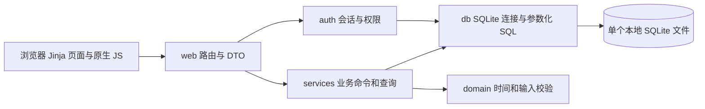
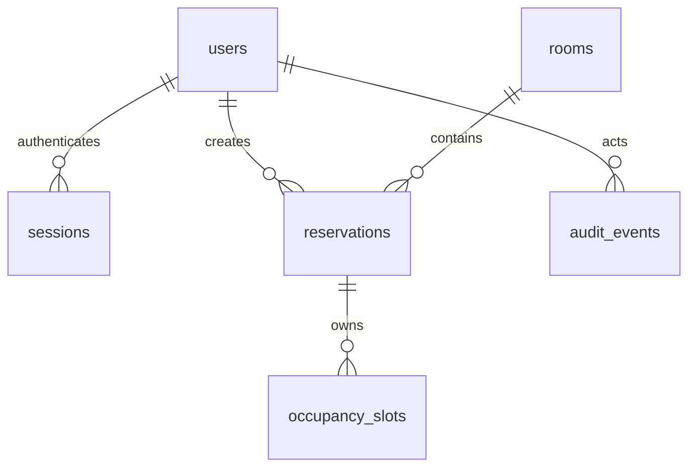

# Architecture Spine — 课题组活动与会议室预约

## Design Paradigm

分层模块化单体。浏览器页面和 JSON API 是同一应用的适配层；身份、预约、资源维护是服务边界；SQLite 是唯一持久化事实来源。详细共享协议以 [architecture.md](../../architecture.md) §4—§8 为准，属于本 spine 的执行附件。技术选择是授权范围内的 AI 设计决策，不是人类逐项采纳记录；`final` 仅在工作流评审完成后使用。



## Invariants & Rules

### AD-1 — 分层单体及唯一写入口

- **Binds:** 全部 FR、NFR-01—04。
- **Prevents:** 路由、后台任务和测试各自绕开相同业务约束。
- **Rule:** 页面和 API 只适配同一服务；全部业务写由 services 拥有，使用 db 的事务助手；domain 不依赖 Flask。无云服务、外部账户或独立前端构建。采用官方 Flask tutorial 的应用工厂与 blueprint 结构，不复制额外 starter 默认行为。

### AD-2 — 时间、区间与状态统一

- **Binds:** BR-01—04、FR-01—03/06—19、NFR-01/02。
- **Prevents:** 查询与提交使用不同的时区、端点和状态判定。
- **Rule:** DB/API 时间为 UTC epoch 整数秒；表单时间严格按 Asia/Shanghai 的 `YYYY-MM-DDTHH:MM` 解析。认证、查询、业务与测试共用注入的 Clock.now_epoch()->int；t>=expires_at 会话失效。写操作取得写锁后捕获一次 t；区间 `[start,end)`；占用槽为 start、start+1800 … end-1800。有效/取消存于记录，待开始/进行中/已结束从当前 t 推导，不持久化派生状态。预约同日且 ≤4h；停用可跨日；两者均遵守 PRD 30 天窗口。

### AD-3 — 统一占用与串行化状态判定

- **Binds:** FR-10—12、FR-17—19、FR-21、NFR-01/04。
- **Prevents:** 两个类型各自合法却同时占用同室、容量检查后被并发改写、业务与审计部分提交。
- **Rule:** 预约和停用共用 reservations 历史表；两类 user_id 都非空且是创建 actor.id，其余 kind/空值矩阵按附件 §5.1；occupancy_slots 用 `(room_id,slot_start)` 主键。每次业务写先 `BEGIN IMMEDIATE`，然后授权复核、校验/读取、业务修改、槽变更、审计、COMMIT；任何失败全量 ROLLBACK。取消仅删除槽，历史不删。禁止 `INSERT OR REPLACE/IGNORE` 吞掉占用冲突。每请求独立连接，外键启用，busy 超时须返回可重试失败，不能当业务冲突或成功。

### AD-4 — 成功提交意图持久重放

- **Binds:** FR-08/12/22、NFR-01/04。
- **Prevents:** 响应丢失导致重复预约、取消后重试被当新请求、跨用户重放。
- **Rule:** 成功预约的 `(user_id,intent_key)` 唯一，保存规范化业务 payload。事务内先按会话用户和 key 查成功记录；同 payload 返回原 ID 及当前状态，不重做时间、容量或占用校验，不新增审计；不同 payload 返回 409。没有成功记录才执行新预约验证。失败回滚不保留 key。

### AD-5 — 可撤销服务端会话与修改请求防护

- **Binds:** FR-01—04、NFR-02。
- **Prevents:** 退出后旧 cookie 仍生效、登录伪造、跨站修改与凭证进入日志。
- **Rule:** 口令用 Werkzeug scrypt；cookie 是 32 字节安全随机 token，DB 仅保存 SHA-256 摘要，用户会话绝对 8h、不滑动续期。登录在锁外验密码，锁内以同一 Clock 重读并一次性消费临时会话、原子插入新会话；同一临时 token 并发仅一次成功，失败不覆盖 cookie。退出在短事务删除当前会话；认证与业务均提交后才响应成功。所有 POST 包括登录/退出须精确匹配 APP_ORIGIN 且通过同步器 CSRF；cookie HttpOnly、SameSite=Lax，HTTPS 时 Secure，仅 loopback 演示允许 HTTP。详见附件 §6，禁止前端自报操作者。

### AD-6 — 服务端授权与白名单输出

- **Binds:** FR-04/07/13—15/20—22、NFR-02。
- **Prevents:** 共享日程泄露他人用途、人数、账号和取消原因，或通过替换 ID 越权。
- **Rule:** 路由和服务接受服务器认证 actor；共享 Booking DTO 仅含会议室、活动名、预约人显示名、起止及状态；本人/管理员详情及审计严格采用附件 §6.3 的完整 DTO/空值合同，日程以 kind+record 判别；create_booking 只返回 CreateBookingResult，web 只加一层 ok/data；所有审计及管理查询仅 admin。非本人和不存在的“本人记录”统一 404。输出必须显式选字段，禁止 DB row 直接序列化，模板保持自动转义。

### AD-7 — 状态转换、容量与审计契约

- **Binds:** FR-14—21、NFR-01/04。
- **Prevents:** 并发取消覆盖先成功原因/操作者，维护容量破坏进行中预约，审计丢失。
- **Rule:** 先授权及校验必填原因，再处理重复取消/撤销；重复返回原结果，无新审计。首次成员取消要求 t<start；首次管理员取消/撤销要求 t<end。降低容量在同一事务检查未取消且 end>t 的预约。命令唯一调用 audit_writer(conn,event)，conn 必须为当前业务事务连接；writer 只 INSERT，不管理连接/事务，事务助手不追加审计。真实变更调用1次，重放/重复/无变化0次；失败整体回滚。`admin_cancel_booking` 和 `revoke_block` 是两个独立命令，共用事务/验证基础，保留各自测试。

### AD-8 — 本地运维与可复验测试边界

- **Binds:** 全部 NFR、FR-01/21/22。
- **Prevents:** 临时内存库掩盖竞争和重启问题、热拷贝漏 WAL、测试改变线上时钟。
- **Rule:** 单主机本地盘、单 Waitress 进程 8 线程、SQLite WAL/FULL/foreign_keys，busy_timeout=15000ms；禁止网络共享盘。备份通过 sqlite3 backup API，停服恢复并清会话；不承诺生产 SLA。Clock 与审计故障点仅由 testing 配置注入，无 HTTP 测试后门。NFR 证据必须使用同一个文件库、独立客户端/连接及最终 DB 断言。

## Consistency Conventions

| Concern | Convention |
| --- | --- |
| IDs | DB INTEGER 主键，API JSON 整数；所有传入 ID 限 1—9223372036854775807，SQL前校验，越界400；鉴权优先，类型由 endpoint/kind 限制 |
| Payload | snake_case；字符串 Python strip 后按 Unicode code point 计数；禁止隐式转换 bool/float 为人数 |
| State | booking: pending/in_progress/ended/cancelled；block: pending/in_progress/ended/revoked |
| Error | JSON `ok:false,error.code,error.message,error.fields,error.conflicts`；成功 `ok:true,data`；不返回 SQL/堆栈 |
| Mutation | 命令通过事务助手拥有提交；路由/模板/writer不commit；唯一writer(conn,event)与业务同连接 |
| Contract authority | 本 spine AD 与课程 architecture 附件一致；若冲突先修文档，不各自选择 |

## Stack

| Name | Version |
| --- | --- |
| CPython | 3.12.14 |
| SQLite（该 Python 实际链接版本） | 3.53.1 |
| Flask | 3.1.3 |
| Jinja2 | 3.1.6 |
| Werkzeug | 3.1.9 |
| Waitress | 3.0.2 |

官方版本核验、兼容性和来源见 [详版 §2](../../architecture.md#2-技术基线与官方核验)。Python/SQLite 为本次已验证基线，不宣称最新；依赖完整锁由实现阶段生成。

## Structural Seed

```text
booking_app/
  __init__.py   # create_app
  web.py        # HTML + JSON adapters
  auth.py       # session, CSRF, actor
  services.py   # command/query ownership
  domain.py     # pure validation and time
  db.py         # connection and transaction helper
  schema.sql
  templates/
  static/
tests/
scripts/        # seed, measure, backup/restore
instance/       # local DB; ignored by Git
```



## Capability → Architecture Map

| Capability / Area | Lives in | Governed by |
| --- | --- | --- |
| FR-01—04 账号会话授权 | auth、初始化 CLI | AD-1/5/6/8 |
| FR-05—07 目录与查询 | services queries、DTO | AD-2/3/6 |
| FR-08—12 创建和重试 | create_booking | AD-2/3/4/5 |
| FR-13—15 个人记录与取消 | own queries、member_cancel、admin_cancel | AD-2/3/6/7 |
| FR-16—17 资源维护 | create_room、update_room | AD-3/7 |
| FR-18—20 停用与管理查询 | create_block、revoke_block、admin queries | AD-2/3/6/7 |
| FR-21—22 审计与反馈 | audit writer、统一错误适配 | AD-3/6/7/8 |
| NFR-01—04 | 并发、安全、性能、重启/故障测试 | AD-2—8 |

## Deferred

- 真实账号、会议室、持续使用保留期限：部署到真实课题组前复核 PRD OQ；演示数据必须标记。
- 云部署、多机与 PostgreSQL 迁移：超出单机负载/需公网服务时重新决策；当前禁止仅换连接串假定兼容。
- 前端视觉细节：由故事决定，不改变 DTO/排序/权限/时间/错误协议。当前列表固定全部匹配；分页只能在后续显式合同变更中增加，1000条仅为性能负载，不是保留上限。
- 12 个故事的最终边界与实验 A 配对：由故事阶段固定；候选管理员取消预约/撤销停用必须保留独立命令，实施前先登记协议。
- 教师 M1/M2 门禁：由真实课程评审记录决定；本架构自检与独立 AI review 不冒充教师批准。
